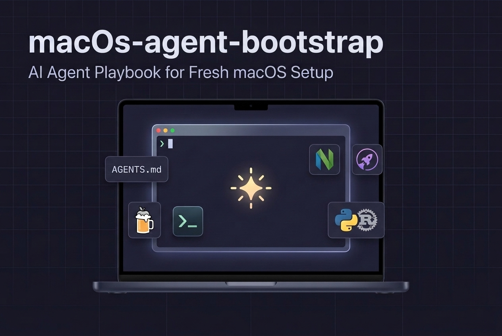

# macos-agent-bootstrap



Interactive AI agent playbook ([`AGENTS.md`](AGENTS.md)) and minimal dotfiles to set up a fresh macOS development environment without bloat.

---

## Philosophy: Fresh & Minimal Core

Instead of bloating a brand-new Mac with dozens of unused language shims and background daemons, this setup installs a **lean, fast core** first and lets your AI agent interactively ask which optional stacks you need:

1. **Minimal Core ([`Brewfile`](Brewfile))**:
   - **[Ghostty](https://ghostty.org/)**: Fast, native GPU-accelerated terminal with built-in Nerd Font symbols.
   - **[Starship](https://starship.rs/)**: Fast, Rust-powered cross-shell prompt (replaces archived Powerlevel10k).
   - **Zsh UX Plugins**: `zsh-autosuggestions` and `zsh-syntax-highlighting`.
   - **[Neovim](https://neovim.io/)**: Lightweight terminal editor (`vim` / `vimdiff` aliased out of the box).
2. **AI-Agent-Safe Shell ([`dotfiles/zshrc`](dotfiles/zshrc))**:
   - Automatically detects IDE and AI agent terminals (`Cursor`, `VS Code`, `Antigravity`) at startup and switches to a clean, single-line prompt with shell-integration hooks so agent commands never hang waiting for async prompt redraws.
3. **Multi-Account Git & SSH Over Port 443 ([`dotfiles/git/`](dotfiles/git/), [`dotfiles/ssh/`](dotfiles/ssh/))**:
   - Templates for single-account or automatic multi-account GitHub routing (`url.insteadOf` + `includeIf`) over `ssh.github.com:443` with macOS Keychain integration.
4. **On-Demand Optional Stacks ([`catalog/optional-packages.md`](catalog/optional-packages.md))**:
   - Curated recipes for **Python (`uv` + `ruff`)**, **GitHub CLI (`gh`)**, **Node (`node`/`pnpm`)**, **Go**, **Swift/Xcode CLI tools**, **Cloud SDKs (`gcloud-cli`, `azure-cli`)**, **PostgreSQL**, **Containers (`OrbStack`/`Docker`)**, and **Media/Docs (`ffmpeg`, `pandoc`, `mactex`)**.

---

## Quick Start (With an AI Agent)

Clone or download this repository on your new Mac, open it in your AI agent, and prompt:

> **"Read `AGENTS.md` and help me set up this Mac for development."**

The agent will:
1. Audit your current macOS environment non-destructively.
2. Ask which Git/SSH setup and optional tool packs you want.
3. Back up any existing dotfiles before installing the core `Brewfile` and configurations.
4. Verify your shell, editor, prompt, and SSH connectivity.

---

## Repository Structure

```text
.
├── AGENTS.md                        # Step-by-step interactive playbook for AI agents
├── CLAUDE.md                        # Entrypoint pointer for Claude Code
├── .cursorrules                     # Rules for Cursor AI composer & agents
├── .github/
│   └── copilot-instructions.md      # Instructions for GitHub Copilot Agent mode
├── llms.txt                         # Context index following llmstxt.org specification
├── Brewfile                         # Minimal core Homebrew bundle (Ghostty, Starship, Neovim, Zsh plugins)
├── README.md                        # Overview and quick start guide
├── catalog/
│   └── optional-packages.md         # Curated optional tool packs (uv, gh, node, go, cloud, etc.)
├── scripts/
│   └── audit.sh                     # Zero-dependency non-destructive system audit script
├── skills/
│   └── mac-setup/
│       └── SKILL.md                 # Agent skill definition for skill-enabled agents
└── dotfiles/
    ├── ghostty/
    │   └── config                   # ~/.config/ghostty/config
    ├── git/
    │   ├── gitconfig-profile.template # ~/.gitconfig-<account>
    │   ├── gitconfig.template       # ~/.gitconfig (single or multi-account)
    │   └── gitignore_global         # ~/.config/git/ignore
    ├── nvim/
    │   └── init.lua                 # ~/.config/nvim/init.lua
    ├── ssh/
    │   └── config.template          # ~/.ssh/config (Port 443 + multi-account keys)
    ├── starship.toml                # ~/.config/starship.toml
    └── zshrc                        # ~/.zshrc (with IDE/AI-agent terminal detection)
```
